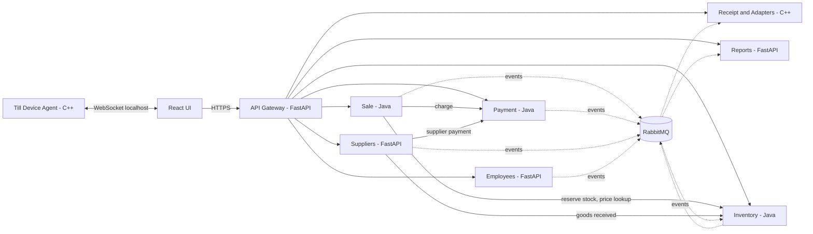
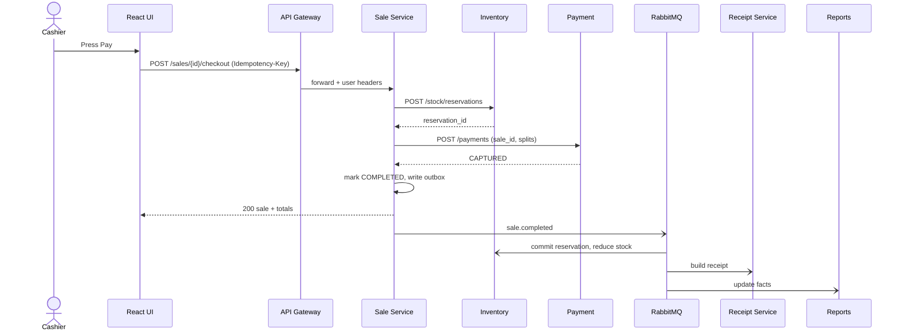
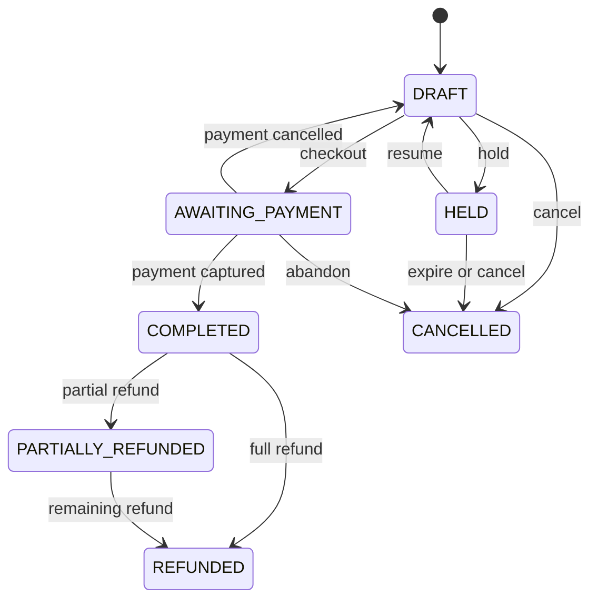
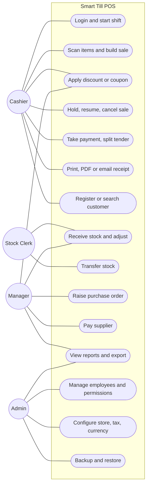
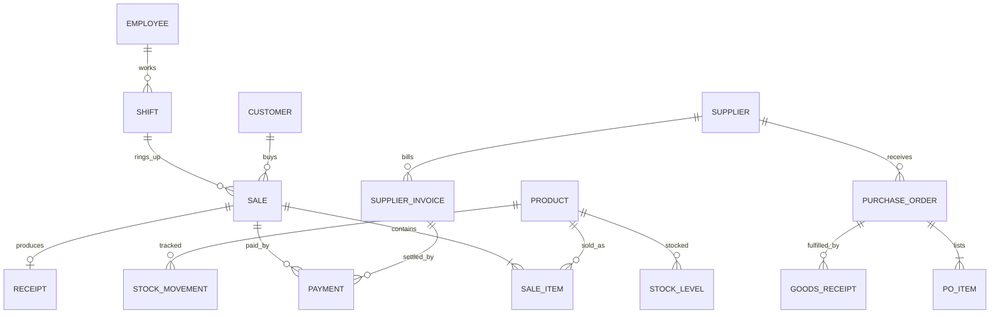

# Smart Till - Supermarket Point of Sale (POS)

A microservice-based POS for a supermarket: it manages the day-to-day flow of goods from suppliers to customers, covering inventory, sales, customers, suppliers, employees, receipts and reporting behind a single API gateway.

> **Status:** design phase. This README describes the target architecture; see [Roadmap](#roadmap) for build order.

---

## Table of contents

- [Features](#features)
- [Architecture](#architecture)
- [Services](#services)
- [Tech stack](#tech-stack)
- [Roles and permissions](#roles-and-permissions)
- [API Gateway](#api-gateway)
- [Key flows](#key-flows)
- [Data design](#data-design)
- [Repository layout](#repository-layout)
- [Getting started](#getting-started)
- [Testing and CI](#testing-and-ci)
- [Roadmap](#roadmap)
- [Contributing](#contributing)

---

## Features

| Area | Capabilities |
|---|---|
| Authentication | Login, argon2id password hashing, JWT, role-based permissions |
| Sales | Add/remove item, quantity, discount, tax, coupon, hold, resume, cancel, multiple payment methods, refunds |
| Inventory | Receive stock, auto-reduce after sales, adjustments, transfers, low-stock alerts, barcodes |
| Customers | Register, search, loyalty points, purchase history |
| Suppliers | Add/edit supplier, purchase orders, goods receipts, invoices, payments |
| Reports | Daily/weekly/monthly sales, top products, top customers, inventory, profit, employee; CSV/Excel/PDF export |
| Employees | Admin, manager, cashier, stock clerk, permissions, shift tracking |
| Receipts | Printable (ESC/POS), PDF, email |
| Backup and settings | DB backup/restore, CSV/Excel export, store info, tax, currency, receipt template, theme |

## Architecture

Every service follows the layering **Presentation (API) => Business Logic => Data Layer => Database**. Services own their data (database per service, no cross-service table access). Synchronous REST is used where the cashier waits on the result; asynchronous events (RabbitMQ, transactional outbox) are used for stock commit, receipts, reporting and alerts.



**Domain events** (JSON, versioned; each carries `event_id`, `occurred_at`, `correlation_id`): `sale.completed`, `sale.cancelled`, `payment.captured`, `payment.refunded`, `stock.committed`, `stock.low`, `po.received`, `shift.closed`.

## Services

| # | Service | Language | Port | Responsibility |
|---|---|---|---|---|
| 1 | **API Gateway** | Python (FastAPI) | 8000 | Single entry point: routing, JWT validation, coarse authorization, rate limiting, aggregation |
| 2 | **Employees** | Python (FastAPI) | 8101 | Users, roles, permissions, login/JWT, shifts, store settings |
| 3 | **Sale** | Java 21 | 8102 | Sale lifecycle, pricing, discounts/coupons, hold/resume, refunds, customers and loyalty, checkout saga |
| 4 | **Inventory** | Java 21 | 8103 | Products, barcodes, prices, stock levels and ledger, reservations, adjustments, transfers, alerts |
| 5 | **Suppliers** | Python (FastAPI) | 8104 | Suppliers, purchase orders, goods receipts, invoices, payment requests |
| 6 | **Payment** | Java 21 | 8105 | Cash/card/mobile/split payments, refunds, supplier payouts, reconciliation |
| 7 | **Reports** | Python (FastAPI) | 8106 | Event-fed star-schema read model, report generation and export |
| 8 | **Receipt and Adapters** | C++20 | 8107 | Receipt rendering (ESC/POS, PDF, email) and device adapters (barcode scanner, printer, cash drawer) |
| 9 | **UI** | React | 5173 (dev) | Cashier POS, inventory, suppliers, reports and admin screens |

Design assumptions: customers and loyalty live in **Sale**; products, prices and stock live in **Inventory**; store settings live in **Employees**; backup is an ops job and CSV/Excel export lives in **Reports**.

### Hardware adapters

Browsers cannot access serial/USB devices directly, so each till runs a **Till Device Agent** (C++) that exposes `ws://localhost:8107/devices`. The React UI receives `scan` events and sends `print` and `drawer.open` commands over that WebSocket.

## Tech stack

| Layer | Choice |
|---|---|
| Languages | C++20, Python 3.13, Java (OpenJDK 21), JavaScript/React |
| Python services | FastAPI, SQLAlchemy, Alembic, pandas/Polars, openpyxl |
| Java services | Spring Boot, JPA/Hibernate, Flyway |
| C++ service | CMake, Boost.Beast/Asio (or Drogon), GoogleTest |
| Frontend | React, Vite, React Router, TanStack Query |
| Messaging | RabbitMQ |
| Database | SQLite (development), PostgreSQL (production, one schema per service) |
| DevOps | Git/GitHub, GitHub Actions, Docker / Docker Compose, Prometheus, OpenTelemetry |

## Roles and permissions

| Permission | Cashier | Stock Clerk | Manager | Admin |
|---|:-:|:-:|:-:|:-:|
| Create / hold / cancel own sale | Y | | Y | Y |
| Override discount, void any sale, refund | | | Y | Y |
| View inventory | Y | Y | Y | Y |
| Receive, adjust, transfer stock | | Y | Y | Y |
| Manage suppliers and purchase orders | | read | Y | Y |
| Approve PO, pay supplier | | | Y | Y |
| View reports | | | Y | Y |
| Manage employees, settings, backup | | | | Y |

## API Gateway

All client traffic goes through `/api/v1/{service}/**`.

- **Auth:** validates RS256 JWTs (public key from the Employees JWKS endpoint); public routes are `POST /auth/login`, `POST /auth/refresh`, `/health`.
- **Authorization:** the route table lists the permission required per route and method.
- **Trusted headers:** injects `X-Request-Id`, `X-User-Id`, `X-User-Role`, `X-Till-Id`; strips client-supplied copies.
- **Resilience:** per-route timeouts, retries for idempotent GETs only, circuit breaker per upstream, rate limiting (stricter on login).
- **Aggregation:** `GET /api/v1/pos/bootstrap` and `GET /api/v1/dashboard`.
- **Docs and ops:** merged OpenAPI at `/docs`, `/health`, `/ready`, Prometheus `/metrics`, structured JSON logs.
- **Idempotency:** `Idempotency-Key` is passed through for sale checkout and payments.
- **Error format:** `{ "error": { "code", "message", "request_id", "details" } }`

## Key flows

### Checkout (saga: reserve, pay, complete, commit)



If payment fails, Sale releases the reservation (compensation) and the sale stays `AWAITING_PAYMENT`.

### Sale lifecycle



### Use cases



## Data design

Cross-service references are by ID only (no foreign keys across services).



Per-service table definitions, class diagrams, sequence, activity and state diagrams are in [`docs/`](docs/) (one file per service).

Key invariants:

- Inventory `on_hand` equals the sum of the append-only `stock_movements` ledger; available = on_hand - reserved.
- A payment is `CAPTURED` only when every split is captured and the splits sum to the total.
- Sale items snapshot name, price and tax so history survives catalog changes.
- Event consumers are idempotent (`processed_events`).

## Repository layout

```text
smart-till/
├── gateway/                 # FastAPI API gateway
├── services/
│   ├── employees/           # FastAPI
│   ├── sale/                # Spring Boot
│   ├── inventory/           # Spring Boot
│   ├── suppliers/           # FastAPI
│   ├── payment/             # Spring Boot
│   ├── reports/             # FastAPI
│   └── receipt-adapters/    # C++20 receipt service + till device agent
├── ui/                      # React app
├── deploy/                  # docker-compose, Nginx, RabbitMQ, Postgres init
├── docs/                    # per-service low-level design
└── README.md
```

## Getting started

> The commands below are the intended workflow; adjust paths once each service is scaffolded.

**Prerequisites:** Git, Docker and Docker Compose, Python 3.13, JDK 21, a C++20 compiler with CMake, Node.js 20+.

```bash
git clone https://github.com/<your-org>/smart-till.git
cd smart-till

# start infrastructure (RabbitMQ, PostgreSQL) and all services
docker compose -f deploy/docker-compose.yml up --build
```

Run a single service locally (SQLite in development):

```bash
# Python service (example: employees)
cd services/employees
python -m venv .venv && source .venv/bin/activate
pip install -r requirements.txt
alembic upgrade head
uvicorn app.main:app --reload --port 8101

# Java service (example: sale)
cd services/sale && ./mvnw spring-boot:run

# C++ service
cd services/receipt-adapters
cmake -S . -B build && cmake --build build
./build/receipt_service

# UI
cd ui && npm install && npm run dev
```

**Configuration** is by environment variables (12-factor). Copy `.env.example` to `.env` in each service and set at minimum the database URL, RabbitMQ URL and, for the gateway, the Employees JWKS URL. Never commit secrets.

Once running: UI at `http://localhost:5173`, gateway at `http://localhost:8000`, merged API docs at `http://localhost:8000/docs`.

## Testing and CI

| Layer | Tools |
|---|---|
| Python | pytest, httpx test client |
| Java | JUnit 5, Testcontainers |
| C++ | GoogleTest |
| UI | Vitest, Playwright |
| Contracts | Pact between services |
| Load | k6 against the checkout path |

GitHub Actions runs lint, tests and image build per service on every pull request.

## Roadmap

1. Gateway skeleton, Employees (login, JWT, roles), React login.
2. Inventory (products, barcodes, stock) and Suppliers (POs, receipts).
3. Sale and Payment (cash first) with the checkout saga.
4. Receipt Service and Device Agent (scanner, printer).
5. Event bus, Reports, card/mobile processors, refunds, backup and hardening.

## Contributing

1. Create a branch from `main`: `feature/<service>-<short-description>`.
2. Keep changes within one service where possible; update that service's doc in `docs/`.
3. Add tests, run linters, and open a pull request with a clear description.
4. Use Conventional Commits (`feat:`, `fix:`, `docs:`, `chore:`).

## License

Add a license of your choice (for example MIT) as `LICENSE` in the repository root.
