# Smart Till POS - Low-Level System Design

Microservice architecture · API Gateway · Python (FastAPI), Java 21, C++20, React

## 1. Scope and design decisions

This design follows your overview PDF and user-flow diagram. Where the brief was silent I made these assumptions; change them if you disagree.

- **Customers + loyalty** are not in your service list, so they live inside the **Sale Service**.
- **Products, prices, barcodes and stock** are owned by the **Inventory Service**. Sale reads price snapshots from it.
- **Settings** (store info, tax, currency, theme) is a small module in the **Employees Service**. The **receipt template** belongs to the Receipt Service.
- **Backup/Restore** is an ops job (pg\_dump/sqlite copy on a schedule). **CSV/Excel export** is in the Reports Service.
- **Database per service.** The diagram shows one DB box; in production that is one PostgreSQL server with one schema (and one DB user) per service. In development each service uses its own SQLite file. No service reads another service's tables.
- **Sync calls** (REST/JSON via the gateway or service-to-service) for anything the cashier waits on; **async events** (RabbitMQ, transactional outbox) for stock commit, receipts, reporting and alerts.
- Layering inside every service follows your rule: Presentation (API) => Business Logic => Data Layer => Database.

## 2. Architecture

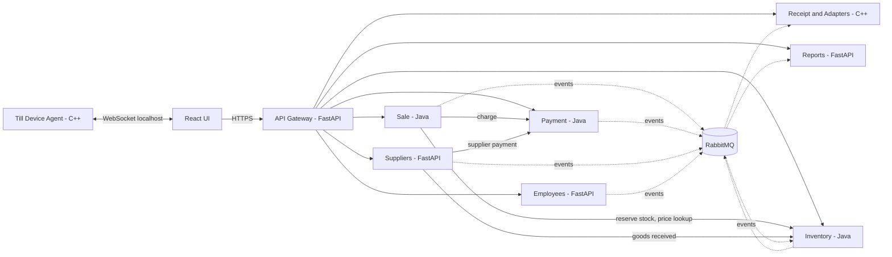

**Domain events** (JSON, versioned, each carries `event_id`, `occurred_at`, `correlation_id`): `sale.completed`, `sale.cancelled`, `payment.captured`, `payment.refunded`, `stock.committed`, `stock.low`, `po.received`, `shift.closed`.

**Ports (suggested):** gateway 8000, employees 8101, sale 8102, inventory 8103, suppliers 8104, payment 8105, reports 8106, receipt 8107, RabbitMQ 5672, Postgres 5432.

## 3. API Gateway requirements (FastAPI)

### 3.1 Functional

| ID | Requirement |
| --- | --- |
| GW-1 | Single public entry point. Route `/api/v1/{service}/**` to the matching internal service via a static route table loaded from config. |
| GW-2 | Validate JWT (RS256) on every request except `POST /auth/login`, `/auth/refresh`, `/health`. Public key fetched from Employees JWKS and cached. |
| GW-3 | Coarse authorization: route table lists the permission needed per route and method; gateway rejects with 403 before forwarding. Services still enforce fine-grained rules. |
| GW-4 | Inject trusted headers: `X-Request-Id`, `X-User-Id`, `X-User-Role`, `X-Till-Id`. Strip any client-supplied versions of these. |
| GW-5 | Rate limiting per user and per IP (token bucket, Redis or in-memory in dev). Stricter limit on login. |
| GW-6 | Timeouts per route (default 5 s, payment 30 s), limited retries for idempotent GETs only, circuit breaker per upstream with fast-fail 503. |
| GW-7 | Aggregated endpoints (BFF): `GET /api/v1/pos/bootstrap` (store settings, tax, current shift, till config) and `GET /api/v1/dashboard` (fan-out to Reports and Inventory). |
| GW-8 | Aggregate each service's OpenAPI into one Swagger UI at `/docs`. |
| GW-9 | CORS allow-list for the React origin; security headers; request size limits. |
| GW-10 | `/health` (liveness) and `/ready` (checks upstream reachability). |
| GW-11 | Structured JSON access logs with request id, user id, route, status, latency; Prometheus metrics at `/metrics`. |
| GW-12 | Pass through `Idempotency-Key` header for POST requests to Sale and Payment. |

### 3.2 Non-functional

- Stateless, horizontally scalable; added latency p95 below 30 ms.
- Services are reachable only on the internal network (docker network / mTLS in production); the gateway is the only exposed port.
- 99.9% availability target for the checkout path; configuration via environment variables (12-factor).
- Uniform error envelope: `{ "error": { "code", "message", "request_id", "details" } }`.

### 3.3 Gateway components

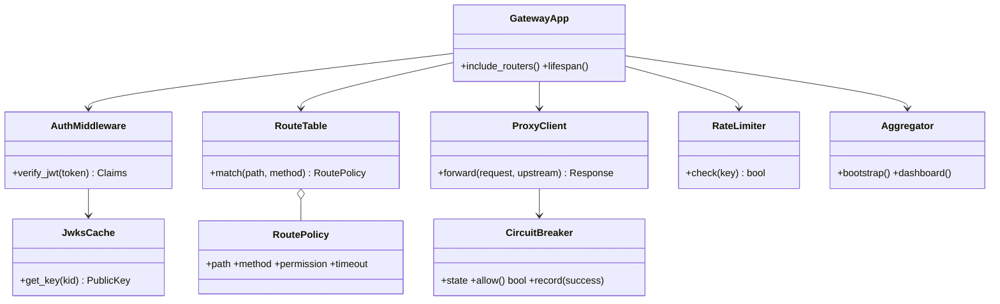

## 4. Whole-system diagrams

### 4.1 Use case diagram

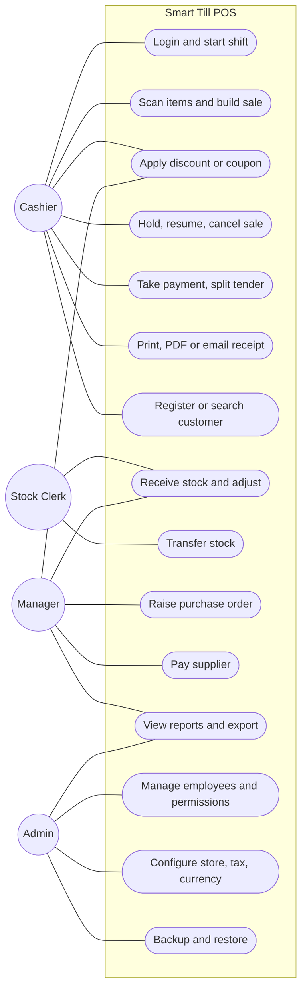

### 4.2 Role and permission matrix (seed data)

| Permission code | Cashier | Stock Clerk | Manager | Admin |
| --- | :-: | :-: | :-: | :-: |
| sale.create / sale.hold / sale.cancel (own) | Y |  | Y | Y |
| sale.discount.override, sale.void.any, refund.create |  |  | Y | Y |
| inventory.read | Y | Y | Y | Y |
| inventory.receive, adjust, transfer |  | Y | Y | Y |
| supplier.read / supplier.write / po.create |  | read | Y | Y |
| po.approve, supplier.pay |  |  | Y | Y |
| report.view |  |  | Y | Y |
| employee.manage, settings.write, backup.run |  |  |  | Y |

### 4.3 Whole-system entity relationship (cross-service links are by ID only, no foreign keys)

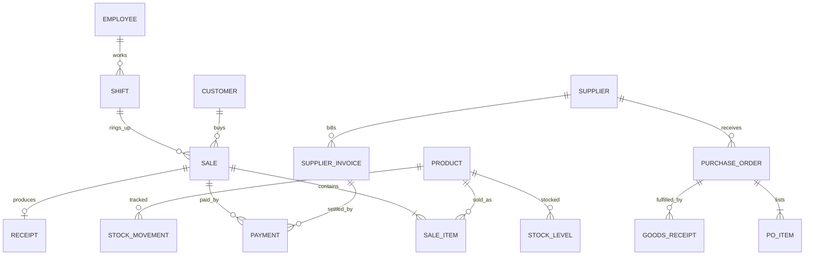

### 4.4 Checkout sequence (saga: reserve, pay, complete, commit)

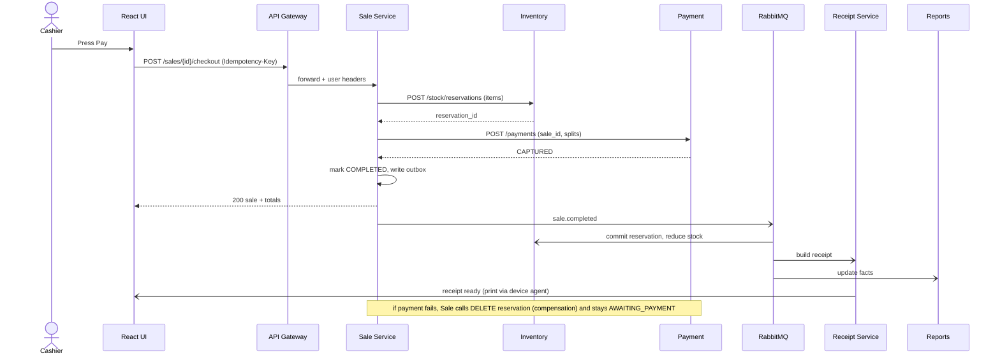

### 4.5 Checkout activity diagram

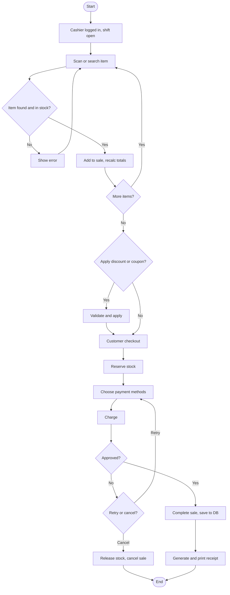

### 4.6 Sale lifecycle state diagram

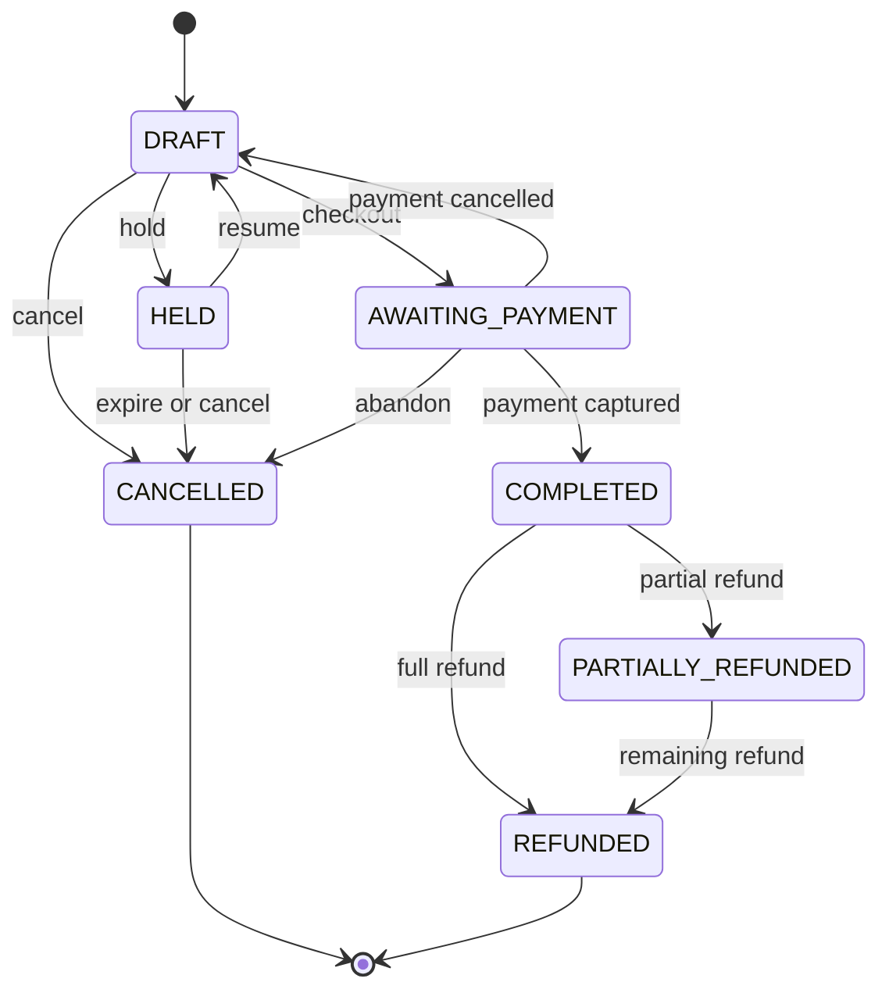

## 5. Employees Service (Python, FastAPI)

**Responsibility:** users, roles, permissions, authentication (JWT issuing), shifts, store settings. Port 8101.

### 5.1 Use cases

| Actor | Use case |
| --- | --- |
| Any employee | Login, logout, refresh token, change password |
| Cashier | Open shift (opening float), close shift (closing cash) |
| Admin | Create/edit/deactivate employee, assign role, reset password, edit role permissions |
| Admin | Edit store info, tax rates, currency, receipt options, theme |
| Manager | View shift history and cash variance |

### 5.2 Database design

| Table | Columns |
| --- | --- |
| employees | id UUID PK, username UNIQUE, email UNIQUE, full\_name, phone, password\_hash (argon2id), role\_id FK, status (PENDING/ACTIVE/LOCKED/DEACTIVATED), failed\_attempts, locked\_until, last\_login\_at, created\_at, updated\_at |
| roles | id PK, name UNIQUE (ADMIN, MANAGER, CASHIER, STOCK\_CLERK), description |
| permissions | id PK, code UNIQUE (e.g. sale.create), description |
| role\_permissions | role\_id FK, permission\_id FK, PK(role\_id, permission\_id) |
| refresh\_tokens | id PK, employee\_id FK, token\_hash, expires\_at, revoked\_at, user\_agent |
| shifts | id PK, employee\_id FK, till\_id, opened\_at, closed\_at, opening\_float, closing\_cash, expected\_cash, variance, status (OPEN/CLOSED) |
| settings | key PK, value JSON, updated\_by, updated\_at (store\_name, address, tax\_rates, currency, theme) |
| audit\_log | id PK, actor\_id, action, entity, entity\_id, before JSON, after JSON, at |

Indexes: employees(username), shifts(employee\_id, status), refresh\_tokens(token\_hash). Rule: one OPEN shift per employee (partial unique index on status = OPEN).

### 5.3 Class diagram

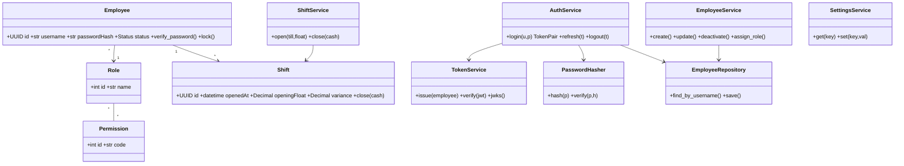

### 5.4 Login sequence

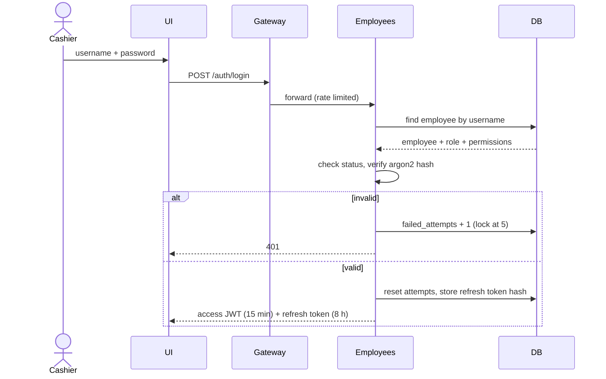

### 5.5 State diagrams

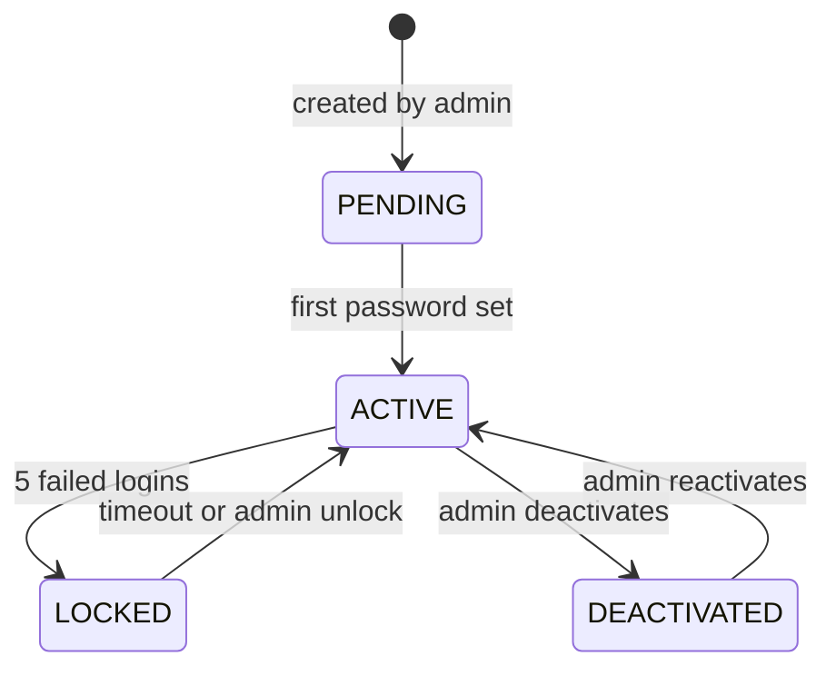

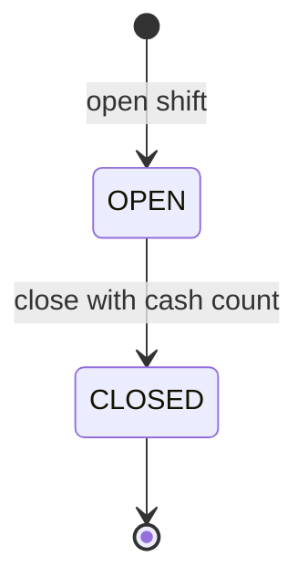

### 5.6 Activity: open shift

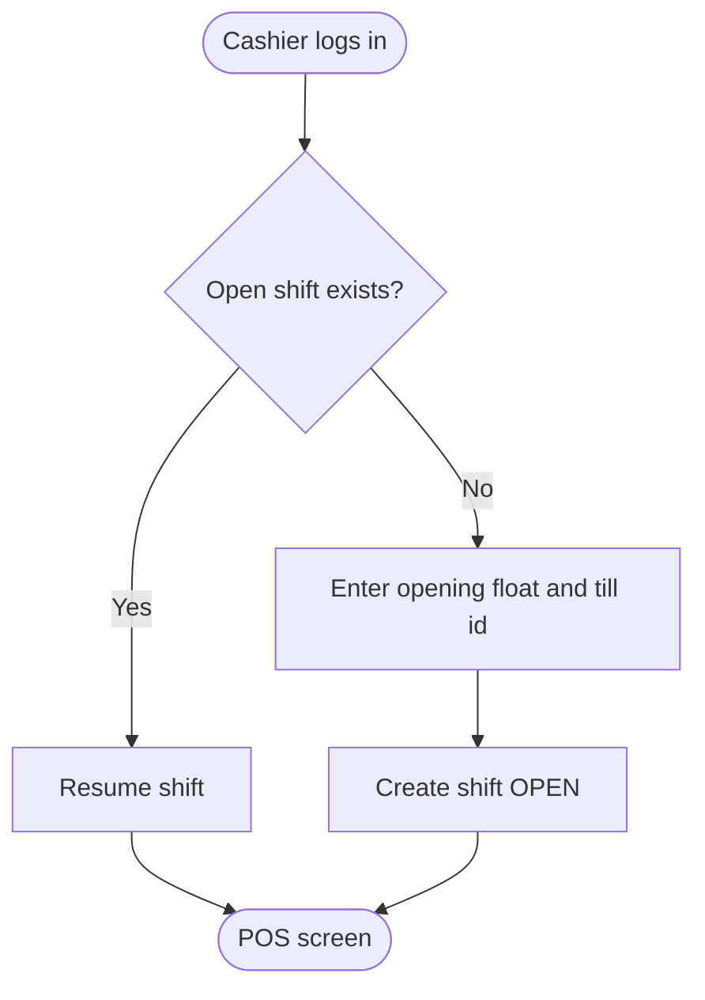

### 5.7 Endpoints

`POST /auth/login` · `POST /auth/refresh` · `POST /auth/logout` · `GET /.well-known/jwks.json` · `GET/POST /employees` · `GET/PATCH/DELETE /employees/{id}` · `GET /roles` · `PUT /roles/{id}/permissions` · `POST /shifts/open` · `POST /shifts/{id}/close` · `GET /shifts` · `GET/PUT /settings/{key}`

## 6. Sale Service (Java 21, Spring Boot)

**Responsibility:** sale lifecycle, pricing (discount, coupon, tax), hold/resume/cancel, refunds, customers and loyalty, checkout orchestration (saga). Port 8102.

### 6.1 Use cases

| Actor | Use case |
| --- | --- |
| Cashier | Start sale, add/remove item, change quantity, apply discount or coupon, hold, resume, cancel own sale, checkout |
| Cashier | Register customer, search customer, attach customer to sale, redeem loyalty points, view purchase history |
| Manager | Override discount, void any sale, issue refund, create/disable coupons |

### 6.2 Database design

| Table | Columns |
| --- | --- |
| sales | id UUID PK, sale\_no UNIQUE, shift\_id, till\_id, cashier\_id, customer\_id NULL, status, subtotal, discount\_total, tax\_total, grand\_total, currency, held\_at, completed\_at, idempotency\_key UNIQUE, created\_at |
| sale\_items | id PK, sale\_id FK, product\_id, barcode, name\_snapshot, unit\_price, quantity, discount\_amount, tax\_rate, tax\_amount, line\_total |
| sale\_discounts | id PK, sale\_id FK, sale\_item\_id NULL, type (PERCENT/FIXED/COUPON/LOYALTY), value, coupon\_id NULL, applied\_by, reason |
| coupons | id PK, code UNIQUE, type, value, min\_spend, valid\_from, valid\_to, max\_uses, used\_count, active |
| refunds | id PK, sale\_id FK, reason, amount, approved\_by, status, created\_at |
| refund\_items | id PK, refund\_id FK, sale\_item\_id FK, quantity, amount |
| customers | id PK, name, phone UNIQUE, email, created\_at |
| loyalty\_accounts | customer\_id PK/FK, points\_balance, tier |
| loyalty\_transactions | id PK, customer\_id FK, sale\_id, points (+/-), type (EARN/REDEEM/ADJUST), created\_at |
| outbox | id PK, aggregate\_id, event\_type, payload JSON, created\_at, published\_at |

Indexes: sales(status, cashier\_id), sales(completed\_at), sale\_items(sale\_id), customers(phone). Names, prices and tax rates are copied into sale\_items so history survives catalog changes.

### 6.3 Class diagram

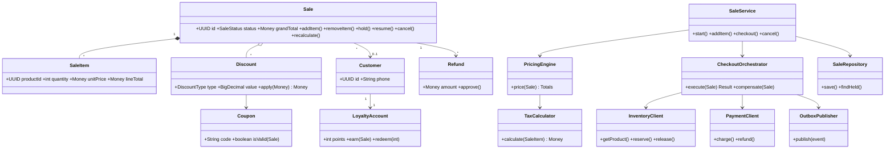

Patterns: Strategy (discount types), Saga + Outbox (checkout), Anti-corruption clients for Inventory and Payment.

### 6.4 Sequence: add item by barcode

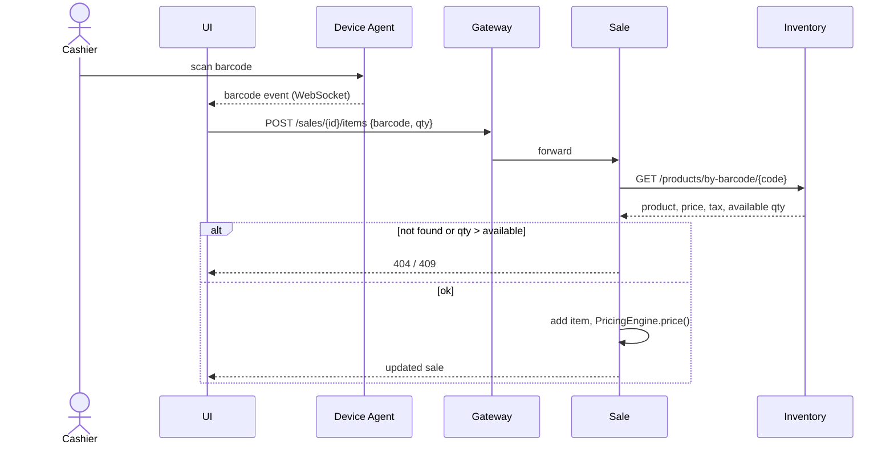

### 6.5 State diagram: refund

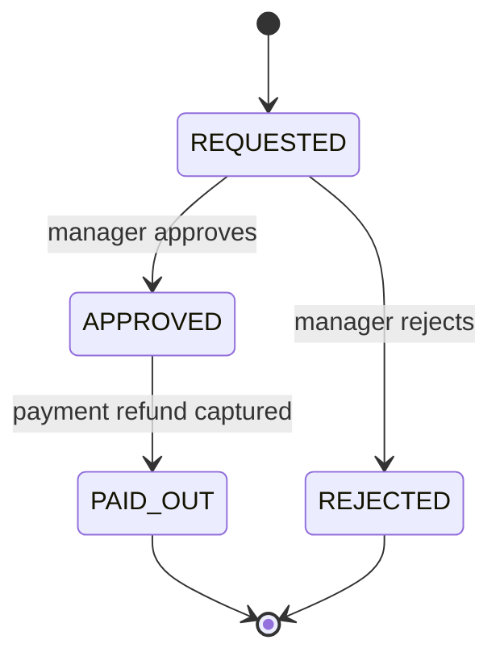

The sale lifecycle state diagram is in section 4.6; the checkout sequence and activity diagrams are in 4.4 and 4.5.

### 6.6 Activity: hold and resume

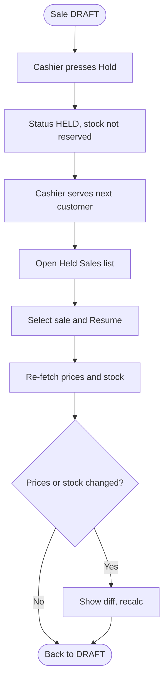

### 6.7 Endpoints

`POST /sales` · `GET /sales/{id}` · `POST/PATCH/DELETE /sales/{id}/items[/{itemId}]` · `POST /sales/{id}/discount` · `POST /sales/{id}/coupon` · `POST /sales/{id}/hold` · `POST /sales/{id}/resume` · `POST /sales/{id}/cancel` · `POST /sales/{id}/checkout` · `GET /sales/held` · `POST /sales/{id}/refunds` · `GET/POST /customers` · `GET /customers/{id}/purchases` · `GET/POST /coupons`

## 7. Inventory Service (Java 21, Spring Boot)

**Responsibility:** product catalog, barcodes, prices, stock levels per location, stock ledger, adjustments, transfers, reservations, low-stock alerts. Port 8103.

### 7.1 Use cases

| Actor | Use case |
| --- | --- |
| Stock Clerk | Receive stock (against a PO or ad hoc), adjust stock (damage, expiry, count), create and receive transfers, print/assign barcodes |
| Manager | Create/edit product and price, set reorder level, view inventory report, acknowledge low-stock alerts |
| Sale Service (system) | Look up product, reserve, release, commit stock |
| Suppliers Service (system) | Post goods receipt |

### 7.2 Database design

| Table | Columns |
| --- | --- |
| products | id UUID PK, sku UNIQUE, name, category\_id FK, unit, cost\_price, sell\_price, tax\_code, reorder\_level, active, created\_at, updated\_at |
| categories | id PK, name, parent\_id NULL |
| product\_barcodes | id PK, product\_id FK, barcode UNIQUE, type (EAN13/UPC/CODE128) |
| locations | id PK, name, type (SHELF/BACKROOM/STORE) |
| stock\_levels | product\_id FK, location\_id FK, on\_hand, reserved, PK(product\_id, location\_id) |
| stock\_movements | id PK, product\_id, location\_id, qty\_delta, type (RECEIPT/SALE/ADJUSTMENT/TRANSFER\_OUT/TRANSFER\_IN/RETURN), ref\_type, ref\_id, actor\_id, at |
| stock\_reservations | id PK, sale\_id, status (ACTIVE/COMMITTED/RELEASED/EXPIRED), expires\_at |
| reservation\_items | reservation\_id FK, product\_id, location\_id, qty |
| stock\_adjustments | id PK, product\_id, location\_id, qty\_delta, reason, approved\_by, at |
| transfers | id PK, from\_location, to\_location, status, created\_by, created\_at, received\_at |
| transfer\_items | transfer\_id FK, product\_id, qty\_sent, qty\_received |
| low\_stock\_alerts | id PK, product\_id, level\_at\_alert, status (OPEN/ACK/RESOLVED), created\_at |
| outbox | as in Sale Service |

Invariant: `on_hand` equals the sum of `stock_movements.qty_delta` for that product and location; the ledger is append-only. Available quantity = on\_hand - reserved.

### 7.3 Class diagram

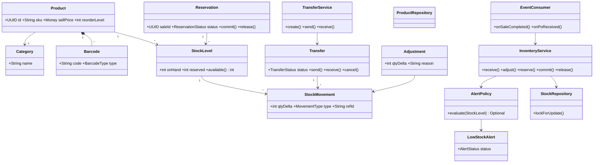

Concurrency: reserve uses `SELECT ... FOR UPDATE` (PostgreSQL) or an optimistic version column (SQLite dev) so two tills cannot oversell the last unit. Unconfirmed reservations expire after 10 minutes via a scheduled job.

### 7.4 Sequence: commit stock and low-stock alert

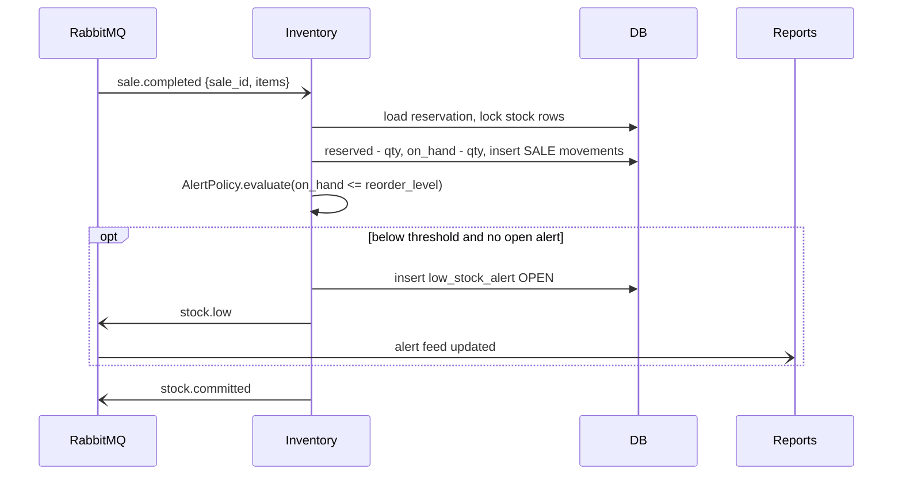

### 7.5 State diagrams

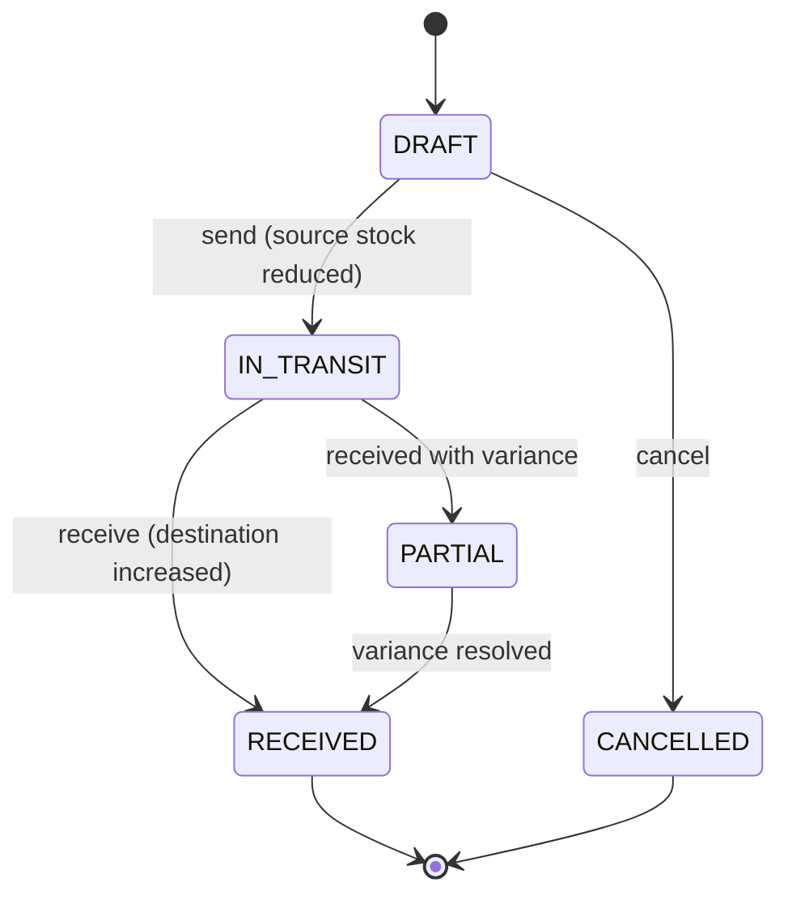

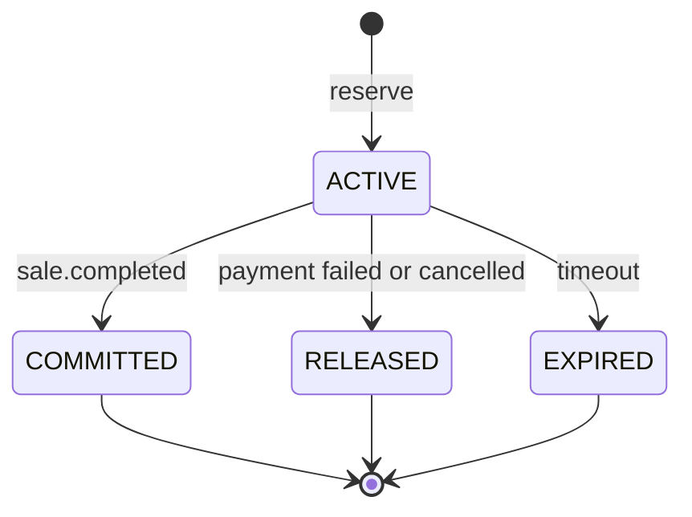

### 7.6 Activity: receive stock

```mermaid
flowchart TD
  A([Goods arrive]) --> B[Clerk opens PO or starts ad hoc receipt]
  B --> C[Scan items, enter quantities]
  C --> D{Matches PO?}
  D -- No --> E[Record variance and note]
  D -- Yes --> F[Confirm]
  E --> F
  F --> G[Write RECEIPT movements, update stock_levels]
  G --> H[Publish stock.received]
  H --> I[Suppliers updates PO status]
  I --> J([End])
```

### 7.7 Endpoints

`GET/POST /products` · `GET/PATCH /products/{id}` · `GET /products/by-barcode/{code}` · `POST /products/{id}/barcodes` · `GET /stock?location=&lowOnly=` · `POST /stock/receive` · `POST /stock/adjust` · `POST /stock/reservations` · `DELETE /stock/reservations/{id}` · `POST/GET /transfers` · `POST /transfers/{id}/send|receive|cancel` · `GET /alerts` · `POST /alerts/{id}/ack` · `GET /reports/stock-valuation`

## 8. Suppliers Service (Python, FastAPI)

**Responsibility:** supplier master data, purchase orders, goods receipts, supplier invoices and payment requests. Port 8104.

### 8.1 Use cases

| Actor | Use case |
| --- | --- |
| Manager | Add/edit supplier, create PO, submit and approve PO, cancel PO, record supplier invoice, pay supplier |
| Stock Clerk | View suppliers and POs, record goods receipt against PO |
| Inventory / Payment (system) | Confirm receipt; confirm payment settled |

### 8.2 Database design

| Table | Columns |
| --- | --- |
| suppliers | id UUID PK, name, tax\_pin, email, phone, address, payment\_terms\_days, status (ACTIVE/INACTIVE), created\_at |
| supplier\_contacts | id PK, supplier\_id FK, name, phone, email, role |
| supplier\_products | supplier\_id FK, product\_id, supplier\_sku, unit\_cost, lead\_time\_days |
| purchase\_orders | id PK, po\_no UNIQUE, supplier\_id FK, status, order\_date, expected\_date, total, created\_by, approved\_by |
| po\_items | id PK, po\_id FK, product\_id, qty\_ordered, qty\_received, unit\_cost |
| goods\_receipts | id PK, po\_id FK, received\_by, received\_at, note |
| grn\_items | id PK, grn\_id FK, po\_item\_id FK, qty\_received, qty\_rejected |
| supplier\_invoices | id PK, supplier\_id FK, po\_id FK, invoice\_no, amount, due\_date, status (UNPAID/PART\_PAID/PAID) |
| supplier\_payments | id PK, invoice\_id FK, payment\_id (from Payment Service), amount, status, paid\_at |

### 8.3 Class diagram

```mermaid
classDiagram
  class Supplier { +int id +str name +status +deactivate() }
  class PurchaseOrder { +str poNo +POStatus status +submit() +approve() +cancel() +apply_receipt() }
  class POItem { +UUID productId +int qtyOrdered +int qtyReceived }
  class GoodsReceipt { +datetime receivedAt }
  class SupplierInvoice { +Decimal amount +date dueDate +mark_paid() }
  class SupplierPayment { +Decimal amount +status }
  class SupplierService { +create() +update() }
  class PurchaseOrderService { +create() +submit() +approve() +receive() }
  class SupplierPaymentService { +pay(invoice) +on_payment_event() }
  class InventoryClient { +post_receipt() }
  class PaymentClient { +create_payout() }
  class SupplierRepository
  Supplier "1" --> "*" PurchaseOrder
  PurchaseOrder "1" *-- "*" POItem
  PurchaseOrder "1" --> "*" GoodsReceipt
  Supplier "1" --> "*" SupplierInvoice
  SupplierInvoice "1" --> "*" SupplierPayment
  PurchaseOrderService --> InventoryClient
  SupplierPaymentService --> PaymentClient
  SupplierService --> SupplierRepository
  PurchaseOrderService --> SupplierRepository
```

### 8.4 Sequence: PO to goods received to supplier payment

```mermaid
sequenceDiagram
  actor M as Manager
  actor K as Stock Clerk
  participant SU as Suppliers
  participant I as Inventory
  participant P as Payment
  M->>SU: create and approve PO
  SU-->>M: PO APPROVED (sent to supplier)
  K->>SU: POST /purchase-orders/{id}/receipts
  SU->>I: POST /stock/receive (items)
  I-->>SU: 201 stock updated
  SU->>SU: update qty_received, PO status
  M->>SU: POST /invoices/{id}/pay
  SU->>P: POST /payments (direction OUT, supplier)
  P-->>SU: CAPTURED
  SU->>SU: invoice PAID
```

### 8.5 State diagram: purchase order

```mermaid
stateDiagram-v2
  [*] --> DRAFT
  DRAFT --> SUBMITTED: submit
  SUBMITTED --> APPROVED: manager approves
  SUBMITTED --> DRAFT: rejected
  APPROVED --> PARTIALLY_RECEIVED: partial goods
  APPROVED --> RECEIVED: all goods
  PARTIALLY_RECEIVED --> RECEIVED: remaining goods
  RECEIVED --> CLOSED: invoice paid
  DRAFT --> CANCELLED
  APPROVED --> CANCELLED
  CLOSED --> [*]
  CANCELLED --> [*]
```

### 8.6 Activity: raise a purchase order from low stock

```mermaid
flowchart TD
  A([Low stock alert]) --> B[Manager reviews alert]
  B --> C[Pick supplier from supplier_products]
  C --> D[Create PO with suggested qty]
  D --> E{Approve?}
  E -- No --> F[Edit or cancel] --> D
  E -- Yes --> G[PO APPROVED, send to supplier]
  G --> H([Await goods])
```

### 8.7 Endpoints

`GET/POST /suppliers` · `GET/PATCH /suppliers/{id}` · `GET/POST /purchase-orders` · `POST /purchase-orders/{id}/submit|approve|cancel` · `POST /purchase-orders/{id}/receipts` · `GET/POST /invoices` · `POST /invoices/{id}/pay` · `GET /suppliers/{id}/statement`
